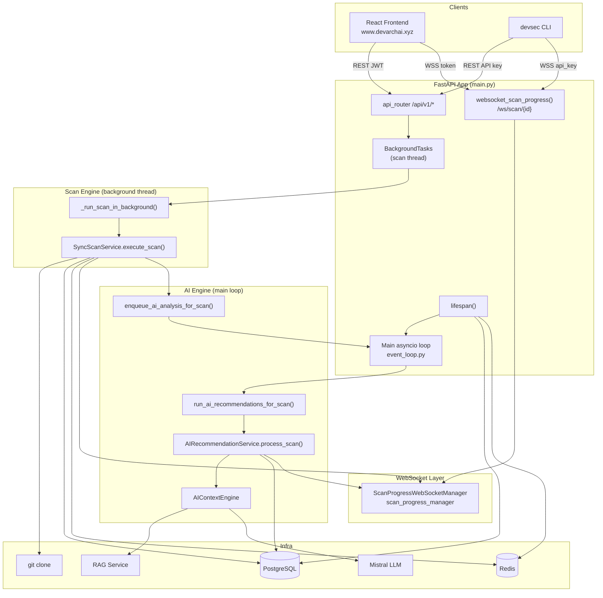
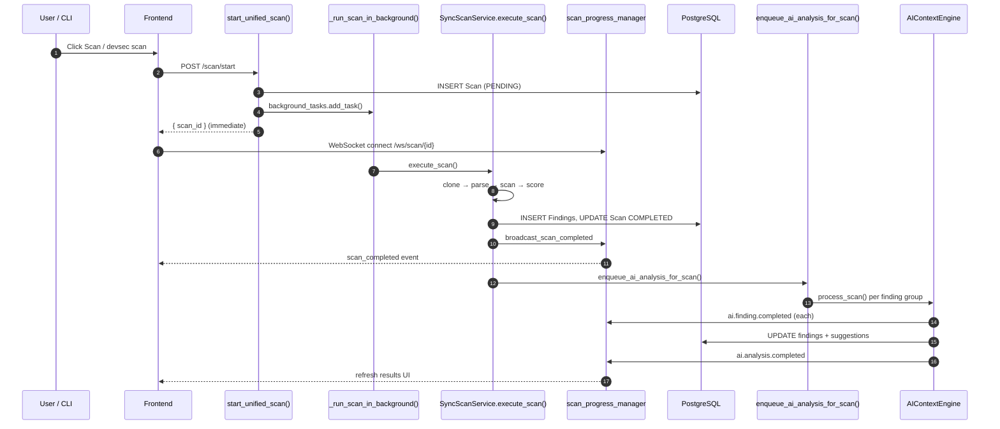

# DevArchAI Architecture & Function Call Flow

This document maps the full system architecture and traces **which function calls what** — from UI clicks and CLI commands through API handlers, background workers, WebSocket broadcasts, and the AI pipeline.

**Production URLs:**
- App: https://www.devarchai.xyz
- API: https://backend.devarchai.xyz/api/v1
- WebSocket: `wss://backend.devarchai.xyz/ws/scan/{scan_id}`

---

## Table of contents

1. [System overview](#1-system-overview)
2. [Tech stack](#2-tech-stack)
3. [Application startup](#3-application-startup)
4. [REST API router map](#4-rest-api-router-map)
5. [Scan flow (full call chain)](#5-scan-flow-full-call-chain)
6. [AI recommendation flow](#6-ai-recommendation-flow)
7. [WebSocket flow](#7-websocket-flow)
8. [Authentication flow](#8-authentication-flow)
9. [View results flow](#9-view-results-flow)
10. [Frontend → Backend reference](#10-frontend--backend-reference)
11. [File / module map](#11-file--module-map)
12. [End-to-end sequence diagram](#12-end-to-end-sequence-diagram)

---

## 1. System overview



---

## 2. Tech stack

| Layer | Technology |
|-------|------------|
| **Frontend** | React, Vite, React Router, TanStack Query, Axios, WebSockets |
| **CLI** | `devsec` (Typer) — same REST + WS APIs |
| **Backend API** | FastAPI (uvicorn), async SQLAlchemy |
| **Database** | PostgreSQL (`Scan`, `Finding`, `Repository`, `User`, `AISuggestion`, …) |
| **Live progress** | Redis progress store + `ScanProgressWebSocketManager` |
| **Scan engine** | `SyncScanService` in a FastAPI `BackgroundTasks` thread |
| **AI** | Mistral LLM, RAG knowledge layer, optional MCP, Redis + PG cache |
| **Auth** | JWT (`access_token` + `refresh_token`), API keys for CLI |
| **Hosting** | Frontend: Vercel · Backend: Render |

---

## 3. Application startup

Runs when the Render service boots.

```
main.py
└── lifespan(app)
    ├── set_main_event_loop(asyncio.get_running_loop())     # core/event_loop.py
    ├── asyncio.create_task(_run_application_startup(app))
    │   ├── init_db()                                        # db/session.py
    │   ├── initialize_knowledge_system()                    # knowledge/registration.py
    │   ├── get_rag_service().seed_from_inventory()          # rag/service.py (background)
    │   ├── get_cache()                                      # Redis
    │   └── recover_pending_ai_scans(limit=25)               # workers/tasks/ai_recommendations.py
    │       └── enqueue_ai_analysis_for_scan(scan_id)        # per stuck scan
    └── yield  → HTTP server starts accepting traffic
```

| File | Role |
|------|------|
| `backend/app/main.py` | App entry, routers, WebSocket registration |
| `backend/app/core/event_loop.py` | `set_main_event_loop`, `schedule_coroutine` |
| `backend/app/api/v1/router.py` | Aggregates all REST routers |

WebSocket routes registered in `main.py`:

```python
@app.websocket("/ws/scan/{scan_id}")
async def websocket_scan_progress(websocket, scan_id):
    await scan_progress_websocket(websocket, scan_id)
```

---

## 4. REST API router map

```
/api/v1  (api_router — backend/app/api/v1/router.py)
├── /auth/*                        → auth.py
├── /scan/*                        → unified_scan.py        ← primary scan entry
├── /scans/*                       → scans.py               ← list, get, findings, cancel
├── /repositories/*                → repositories.py
├── /repositories/{id}/results     → repository_results.py
├── /github/*                      → github.py
├── /gitlab/*                      → gitlab.py + gitlab_auth.py
├── /dashboard/*                   → dashboard.py
├── /findings/*                    → findings.py
├── /ai-suggestions/*              → ai_suggestions.py
├── /reports/*                     → reports.py
├── /settings/*                    → settings.py
├── /billing/*                     → billing.py
└── /health/*                      → health.py

/ws/scan/{scan_id}                 → scan_progress_websocket()  (main.py)
/ws/cloud/{connection_id}          → cloud WebSocket            (main.py)
```

### Frontend routes (`frontend/src/App.tsx`)

| URL | Page component |
|-----|----------------|
| `/` | `Landing` |
| `/scan` | `ScanPage` (guest scan) |
| `/login`, `/register` | `Login`, `Register` |
| `/dashboard` | `Dashboard` |
| `/repositories` | `RepositoriesPage` |
| `/repositories/:id/results` | `RepositoryResultsPage` |
| `/scans/:id` | `ScanProgressPage` |
| `/history` | `ScanHistoryPage` |
| `/settings` | `SettingsPage` |
| `/docs` | `DocsPage` |

---

## 5. Scan flow (full call chain)

### 5.1 Trigger paths

| Entry | Frontend / CLI | HTTP | Backend handler |
|-------|----------------|------|-----------------|
| Guest scan | `ScanPage.handleSubmit()` → `scansApi.startUnifiedScan()` | `POST /api/v1/scan/start` | `start_unified_scan()` |
| Repo page (Play) | `RepositoriesPage.handleScan()` → `triggerScanMutation` | same | same |
| CLI | `scan_cmd` → `start_scan()` → `client.post_json("/scan/start")` | same | same |

### 5.2 `start_unified_scan()` call chain

File: `backend/app/api/v1/routes/unified_scan.py`

```
start_unified_scan(request, background_tasks, db, current_user)
├── get_optional_user()                         # auth dependency
├── db: select Repository (if repository_id provided)
├── resolve_repository_branch()                 # utils/github_branch.py
├── db: create Scan(status=PENDING, progress=0)
├── db: create AnonymousScan (guest only) + session_token
├── get_scan_progress_store().create_scan(scan_id)
└── background_tasks.add_task(
        _run_scan_in_background,
        scan_id, repository_url, branch, include_ai_explanations, session_token
    )
    → returns { scan_id, session_token?, status: "pending" } immediately
```

### 5.3 `_run_scan_in_background()` call chain

```
_run_scan_in_background(scan_id, repository_url, branch, ...)
├── asyncio.new_event_loop()                    # dedicated loop for this thread
├── get_sync_session_factory()()                # sync DB session
├── get_scan_progress_store()
│   ├── store.create_scan(scan_id)
│   ├── store.update_status("running", 5)
│   └── store.add_log(...)
├── SyncScanService(db, progress_store, scan_id, event_loop)
└── scan_service.execute_scan(sync_scan)        # ← main scan pipeline
```

### 5.4 `SyncScanService.execute_scan()` — phase by phase

File: `backend/app/workers/tasks/scan_repository.py`

```
SyncScanService.execute_scan(scan)
│
├── [CONNECTING]
│   ├── _transition_stage(scan, ScanStage.CONNECTING, ...)
│   │   ├── lifecycle_stage_for_internal()      # services/scan_lifecycle.py
│   │   ├── _update_progress_async()
│   │   └── scan_progress_manager.broadcast_scan_progress()
│   └── scan_progress_manager.broadcast_scan_started()
│
├── [CLONING]
│   ├── _transition_stage(scan, ScanStage.CLONING, ...)
│   └── RepositoryScanner.clone_repository()    # utils/repository_scanner.py
│       └── git clone (uses settings.GITHUB_TOKEN)
│
├── [TECHNOLOGY DETECTION]
│   ├── _collect_all_files(repo_path)
│   ├── detect_technology_stack_from_files()
│   ├── progress_store.update_detected_stack()
│   ├── scan_progress_manager.broadcast_stack_detected()
│   └── _emit_technology_detected()
│
├── [FILE PARSING]
│   └── _load_and_parse_files()
│       └── ParserRegistry (Dockerfile, K8s, Terraform, CI/CD parsers)
│
├── [SCANNER SELECTION]
│   └── _transition_stage(scan, ScanStage.SCANNER_SELECTION, ...)
│
├── [RULE ENGINE]
│   ├── _extract_resources(parsed_files)
│   └── _run_rules(resources, parsed_files)     # RuleRegistry
│
├── [EXTERNAL SCANNERS]
│   ├── ScannerRegistry.get_available_ids()
│   ├── scan_progress_manager.broadcast_scanner_start()   (per scanner)
│   ├── ScannerRegistry.run_for_repo()
│   ├── deduplicate_across_scanners()
│   ├── scan_progress_manager.broadcast_scanner_complete()  (per scanner)
│   └── db: ScannerExecutionRecord (persist)
│
├── [NORMALIZATION]
│   ├── _transition_stage(scan, ScanStage.NORMALIZATION, ...)
│   └── enrich_findings()                       # services/findings_enricher.py
│
├── [DEDUPLICATION]
│   ├── _transition_stage(scan, ScanStage.DEDUPLICATION, ...)
│   └── deduplicate_findings()                  # services/findings_deduplicator.py
│
├── [VALIDATION]
│   └── validate_findings()                     # services/finding_validator.py
│
├── [SCORING + PERSIST]
│   ├── ScoringEngine.calculate_scores()
│   ├── _transition_stage(scan, ScanStage.REPORT_GENERATION, ...)
│   ├── _save_findings()                        # → Finding rows in PostgreSQL
│   ├── _emit_technology_findings_counts()
│   ├── ReportService → _create_report()        # → Report row
│   ├── scan.status = COMPLETED, progress = 100
│   ├── scan.ai_status = "pending" (if findings exist)
│   └── db.commit()
│
├── [BROADCAST COMPLETE]
│   ├── progress_store.complete_scan()
│   ├── scan_progress_manager.broadcast_progress(status="completed")
│   ├── scan_progress_manager.broadcast_scan_stage("scan_completed")
│   └── scan_progress_manager.broadcast_scan_completed()
│
└── [TRIGGER AI — non-blocking]
    └── enqueue_ai_analysis_for_scan(scan.id)
```

### 5.5 Scan lifecycle stages (UI labels)

Defined in `backend/app/services/scan_lifecycle.py`:

| Order | Stage key | UI label |
|-------|-----------|----------|
| 0 | `queued` | Queued |
| 1 | `connecting_repository` | Connect to repository |
| 2 | `cloning` | Clone repository |
| 3 | `cloned` | Repository cloned |
| 4 | `detecting_technologies` | Detect technologies |
| 5 | `scanning` | Security scan |
| 97 | `analyzing` | Analyze findings |
| 99 | `scan_completed` | Scan complete |

---

## 6. AI recommendation flow

Triggered automatically after `execute_scan()` commits `COMPLETED` with `ai_status = "pending"`.

### 6.1 Enqueue routing

File: `backend/app/services/ai_recommendation_service.py`

```
enqueue_ai_analysis_for_scan(scan_id)
│
├── [path A] CELERY_AI_TASKS_ENABLED=true
│   └── enqueue_ai_analysis.delay(scan_id)      # workers/tasks/ai_recommendations.py
│       └── _run_pipeline_sync(scan_id)
│           └── asyncio.run(run_ai_recommendations_for_scan())
│
├── [path B] default production (main uvicorn loop)
│   └── _schedule_ai_on_main_loop(scan_id)
│       └── schedule_coroutine(_run_ai_job())   # core/event_loop.py
│           └── asyncio.run_coroutine_threadsafe(coro, main_loop)
│               └── _run_ai_job(scan_id)
│                   └── run_ai_recommendations_for_scan(scan_id, session)
│
└── [path C] fallback (no main loop available)
    └── threading.Thread(_thread_runner)
        └── _run_pipeline_sync(scan_id)
```

> **Production default:** `CELERY_AI_TASKS_ENABLED=false` — AI runs on the main uvicorn event loop so DB/Redis/WebSocket clients are not bound to a different loop.

### 6.2 `AIRecommendationService.process_scan()` internals

```
AIRecommendationService.process_scan(scan_id)
├── db: load Scan + findings (selectinload)
├── scan.ai_status = "processing"
├── _broadcast_started()
│   ├── scan_progress_manager.broadcast_ai_started()
│   ├── scan_progress_manager.broadcast_ai_analysis_started()
│   └── scan_progress_manager.broadcast_ai_progress()
│
└── _run_pipeline(scan)
    └── for each deduplicated finding group:
        ├── RecommendationCache.get(key)        # Redis L1 + PostgreSQL L2
        │
        ├── [CACHE HIT]
        │   ├── _recommendation_from_entry()
        │   └── _broadcast_cache_hit()
        │
        └── [CACHE MISS]
            ├── AIContextEngine.build_context(finding)
            │   ├── _retrieve_rule_knowledge()  → RAG service
            │   └── _fetch_live_context()       → MCP (if required)
            ├── _broadcast_rag_completed()
            ├── _broadcast_mcp_completed()      (if MCP used)
            ├── _broadcast_llm_started()
            ├── AIContextEngine.generate_recommendation()
            │   ├── _build_prompt()
            │   └── _call_llm()                 → Mistral provider
            ├── _broadcast_llm_completed()
            ├── _persist_recommendation()       → cache + DB
            ├── _apply_to_findings()            → update Finding rows
            ├── _upsert_suggestions()           → AISuggestion rows
            └── _broadcast_finding_completed()
│
├── scan.ai_status = "completed"
├── _broadcast_completed()
│   ├── scan_progress_manager.broadcast_ai_analysis_completed()
│   └── scan_progress_manager.broadcast_ai_completed()
└── return AIRecommendationRunResult
```

### 6.3 Restart recovery

On deploy/restart, `main.py` calls:

```
recover_pending_ai_scans(limit=25)
└── for each Scan where ai_status == "pending":
    └── enqueue_ai_analysis_for_scan(scan_id)
```

---

## 7. WebSocket flow

### 7.1 Backend connection chain

File: `backend/app/websockets/scan_progress.py`

```
main.py: websocket_scan_progress(websocket, scan_id)
└── scan_progress_websocket(websocket, scan_id)
    ├── _authenticate_websocket()
    │   ├── ?token=       JWT (browser)
    │   ├── ?api_key=     API key (CLI)
    │   └── ?session_token=  guest scan
    ├── scan_progress_manager.connect(websocket, scan_id)
    │   ├── websocket.accept()
    │   └── send connection_ack
    └── loop: websocket.receive_text()
        ├── ping → pong
        └── disconnect → scan_progress_manager.disconnect()
```

### 7.2 Backend broadcast chain

```
SyncScanService / AIRecommendationService
└── scan_progress_manager.broadcast_*()
    └── _broadcast_to_scan(scan_id, message)
        └── websocket.send_text(JSON)  → all clients for scan_id
```

Key `broadcast_*` methods on `ScanProgressWebSocketManager`:

| Method | When called |
|--------|-------------|
| `broadcast_scan_started` | Scan begins |
| `broadcast_scan_progress` / `broadcast_stage_transition` | Stage changes |
| `broadcast_progress` | Progress % updates |
| `broadcast_scanner_start` / `broadcast_scanner_complete` | Per-scanner events |
| `broadcast_finding_detected` | Live finding stream |
| `broadcast_scan_completed` | Scan finished |
| `broadcast_ai_analysis_started` | AI pipeline starts |
| `broadcast_ai_finding_completed` | One finding group done |
| `broadcast_ai_analysis_completed` | All AI done |

### 7.3 Frontend receive chain

File: `frontend/src/hooks/useScanWebSocket.ts`

```
useScanWebSocket({ scanId, sessionToken, onComplete, onAIComplete })
├── buildWebSocketUrl(`/ws/scan/${scanId}?token=...`)
├── ws.onmessage → parse JSON
└── switch (type):
    ├── stage_transition / scan_stage  → ScanPipeline UI
    ├── progress_update                → progress bar
    ├── scanner_start / scanner_complete → ScannerCards
    ├── finding_detected               → LiveFindingsStream
    ├── scan_completed                 → onComplete() → fetch results
    ├── ai.analysis.started            → AIGenerationPanel
    ├── ai.finding.completed           → AI progress counter
    └── ai.analysis.completed          → onAIComplete() → refresh findings
```

**Fallback polling** (if WebSocket drops):

- `GET /api/v1/scan/state/{scan_id}`
- `GET /api/v1/scan/status/{scan_id}`

---

## 8. Authentication flow

### 8.1 Login (browser)

```
Login.handleSubmit()                          # pages/auth/Login.tsx
├── authApi.login({ email, password })
│   └── POST /api/v1/auth/login
│       └── auth.login()                      # api/v1/routes/auth.py
│           ├── db: select User by email_hash
│           ├── verify_password()
│           ├── create_access_token() + create_refresh_token()
│           └── audit_logger.log("auth.login.success")
├── useAuthStore.login(access_token)          → localStorage
├── authApi.getCurrentUser()
│   └── GET /api/v1/auth/me → auth.get_me()
└── navigate('/dashboard')
```

### 8.2 Protected route

```
App.ProtectedRoute
└── useAuthStore.checkAuth()                  # stores/auth-store.ts
    ├── read localStorage access_token
    └── authApi.getCurrentUser() → GET /auth/me
```

### 8.3 Token refresh (automatic)

```
frontend/src/lib/api.ts — axios response interceptor
└── on 401:
    └── POST /api/v1/auth/refresh
        └── retry original request with new access_token
```

### 8.4 API key (Settings → CLI)

```
SettingsPage → authApi.createApiKey()
└── POST /api/v1/auth/api-key → auth.create_api_key()

CLI:
devsec auth login
└── ApiClient stores token in ~/.devsec/config
    └── Authorization: Bearer <api_key> on all requests
    └── WebSocket: ?api_key=<key>
```

---

## 9. View results flow

### 9.1 Scan detail `/scans/{id}`

```
ScanProgressPage
├── useScanWebSocket(scanId)                  # live during scan
├── scansApi.getScanState(scanId)               # GET /scan/state/{id}
└── on complete:
    scansApi.getScanResults(scanId)
    ├── GET /scans/{id}
    └── GET /scans/{id}/findings
    → ScanResultsDashboard
```

### 9.2 Repository results `/repositories/{id}/results`

```
RepositoryResultsPage
└── GET /api/v1/repositories/{id}/results
    └── repository_results.get_repository_results()
        ├── db: latest completed Scan for repository
        └── db: Finding rows + aggregated stats
```

### 9.3 Scan history `/history`

```
ScanHistoryPage
└── scansApi.listScans()
    └── GET /api/v1/scans?page=1&page_size=100
```

---

## 10. Frontend → Backend reference

| User action | React component | API client | Backend handler | Core service |
|-------------|-----------------|------------|-----------------|--------------|
| Start guest scan | `ScanPage.handleSubmit` | `scansApi.startUnifiedScan` | `start_unified_scan` | `_run_scan_in_background` → `execute_scan` |
| Scan repo (Play) | `RepositoriesPage.handleScan` | `scansApi.startUnifiedScan` | same | same |
| Watch progress | `useScanWebSocket` | WebSocket | `scan_progress_websocket` | `scan_progress_manager.broadcast_*` |
| View scan results | `ScanProgressPage` | `getScanResults` | `scans.get_scan` + `get_findings` | DB read |
| Login | `Login.handleSubmit` | `authApi.login` | `auth.login` | JWT creation |
| Create API key | `SettingsPage` | `authApi.createApiKey` | `auth.create_api_key` | DB update |
| Import GitHub repo | `RepoSelectionModal` | `importGitHubRepositories` | `github.import_repos` | DB insert Repository |
| CLI scan | `scan_cmd` | `start_scan` | `start_unified_scan` | same as UI |

### CLI scan chain

```
devsec scan --project <id> --branch main
└── cli/commands/scan_cmd.py
    ├── resolve_project() / get_project()
    ├── start_scan(client, repository_url, repository_id, branch)
    │   └── POST /api/v1/scan/start
    ├── ProgressTracker (WebSocket + poll fallback)
    │   └── wss://.../ws/scan/{id}?api_key=...
    └── get_scan_results(client, scan_id)
        └── GET /api/v1/scan/results/{id}
```

---

## 11. File / module map

```
DevArchAI/
├── frontend/src/
│   ├── App.tsx                         # Routes + ProtectedRoute
│   ├── lib/api.ts                      # Axios, JWT refresh, buildWebSocketUrl
│   ├── api/endpoints/
│   │   ├── scans.ts                    # scansApi.*
│   │   ├── repositories.ts             # repositoriesApi.*
│   │   └── auth.ts                     # authApi.*
│   ├── hooks/
│   │   ├── useScanWebSocket.ts         # WS message dispatch
│   │   └── useRepositoryScan.ts        # Repo scan state machine
│   └── pages/
│       ├── ScanPage.tsx                # Guest scan form → /scan
│       ├── ScanProgressPage.tsx        # /scans/:id
│       ├── repositories/RepositoriesPage.tsx
│       └── repositories/RepositoryResultsPage.tsx
│
├── cli/src/devsec/
│   ├── commands/scan_cmd.py            # devsec scan
│   ├── api/scans.py                    # start_scan, get_scan_state, get_scan_results
│   └── api/client.py                   # HTTP client + auth header
│
└── backend/app/
    ├── main.py                         # FastAPI app, lifespan, WS routes
    ├── config.py                       # CELERY_AI_TASKS_ENABLED, LLM_PROVIDER, …
    ├── core/event_loop.py              # Main loop scheduling for AI
    ├── api/v1/
    │   ├── router.py                   # Route aggregation
    │   └── routes/
    │       ├── unified_scan.py         # POST /scan/start ← scan entry
    │       ├── scans.py                # GET /scans/*
    │       ├── auth.py                 # Login, API keys, sessions
    │       └── repository_results.py   # GET /repositories/{id}/results
    ├── workers/tasks/
    │   ├── scan_repository.py          # SyncScanService.execute_scan
    │   └── ai_recommendations.py       # Celery task + recover_pending_ai_scans
    ├── services/
    │   ├── ai_recommendation_service.py
    │   ├── scan_lifecycle.py           # Stage labels and progress math
    │   ├── scan_progress_store.py      # Redis-backed progress state
    │   ├── findings_enricher.py
    │   ├── findings_deduplicator.py
    │   └── finding_validator.py
    ├── websockets/
    │   └── scan_progress.py            # scan_progress_manager + WS handler
    ├── ai/context_engine.py            # RAG + LLM orchestration
    ├── scanners/registry.py            # External scanner runner
    ├── rule_engine/base.py             # Rule engine
    ├── scoring/engine.py               # Score calculation
    └── utils/
        ├── repository_scanner.py       # git clone
        └── github_branch.py            # main/master → real default branch
```

---

## 12. End-to-end sequence diagram



---

## Environment variables (production scan + AI)

| Variable | Purpose | Production value |
|----------|---------|------------------|
| `CELERY_AI_TASKS_ENABLED` | Route AI to Celery worker | `false` (or unset) |
| `LLM_PROVIDER` | LLM backend | `mistral` |
| `MISTRAL_API_KEY` | Mistral auth | required |
| `MISTRAL_MODEL` | Model name | e.g. `mistral-large-latest` |
| `RAG_ENABLED` | Knowledge grounding | `true` |
| `GITHUB_TOKEN` | Private repo clone | optional |

---

*Last updated: 2026-08-26*
